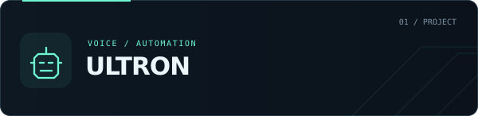
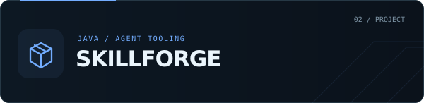
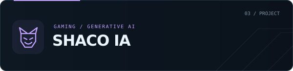
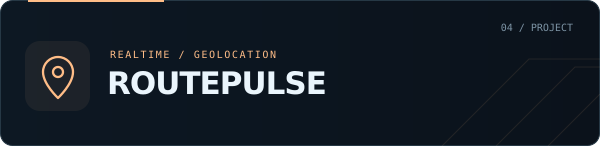

<div align="center">



<br />

<a href="https://www.linkedin.com/in/davi-bernardo-souza-95243532b/"></a>
&nbsp;
<a href="mailto:davibernardosouza@gmail.com"></a>
&nbsp;
<a href="https://github.com/DaviBernardosouzs?tab=repositories"></a>

</div>

<br />

## `01` / Sobre mim

Sou **Davi Bernardo**, desenvolvedor com foco em **backend e inteligência artificial aplicada**, estudante de Ciência da Computação na **Unileste**, em Minas Gerais.

Desenvolvo APIs com **Java e Spring Boot** e exploro como conectar modelos de linguagem a ferramentas, voz, memória e automações. Meus projetos também passam por **Python**, **C# / .NET** e aplicações desktop: gosto de entender o caminho completo entre uma ideia e um sistema funcionando.

```yaml
foco:       Backend · APIs · IA aplicada
construindo: Assistentes · Ferramentas para agentes · Integrações
estudando:  Arquitetura de software · Sistemas distribuídos
interesses: Física · Astrofísica · Escrita
```

## `02` / Projetos em destaque

<table>
<tr>
<td width="50%" valign="top">
<a href="https://github.com/DaviBernardosouzs/ultron"></a>
<p><strong>Um assistente conectado ao mundo real.</strong></p>
<p>Assistente em português que combina LLMs, reconhecimento e síntese de voz, memória e ferramentas para interagir com dispositivos da rede local.</p>
<p>Integração via MCP, interface desktop e controle de permissões para ações.</p>
<p><code>Python</code> <code>LLMs</code> <code>MCP</code> <code>Whisper</code> <code>Piper</code></p>
<a href="https://github.com/DaviBernardosouzs/ultron"><strong>Explorar Ultron ↗</strong></a>
</td>
<td width="50%" valign="top">
<a href="https://github.com/DaviBernardosouzs/skillforge"></a>
<p><strong>Estrutura para o conhecimento dos agentes.</strong></p>
<p>API que gera bibliotecas de Agent Skills como repositórios Git, com validação, templates e exportação em ZIP.</p>
<p>Cada biblioteca também vira um vault do Obsidian, com um grafo de skills, referências e categorias.</p>
<p><code>Java</code> <code>Spring Boot</code> <code>JGit</code> <code>Obsidian</code></p>
<a href="https://github.com/DaviBernardosouzs/skillforge"><strong>Explorar SkillForge ↗</strong></a>
</td>
</tr>
<tr>
<td width="50%" valign="top">
<a href="https://github.com/DaviBernardosouzs/shaco-ia"></a>
<p><strong>IA dentro da experiência de jogo.</strong></p>
<p>Assistente para League of Legends com overlay, chat e voz, integração com Gemini e dados locais do jogo.</p>
<p>Reúne recomendações de builds, reações aos eventos da partida e resumos com pontos de melhoria.</p>
<p><code>JavaScript</code> <code>Electron</code> <code>Gemini</code> <code>APIs</code></p>
<a href="https://github.com/DaviBernardosouzs/shaco-ia"><strong>Explorar Shaco IA ↗</strong></a>
</td>
<td width="50%" valign="top">
<a href="https://github.com/DaviBernardosouzs/route-pulse"></a>
<p><strong>Do navegador ao mapa, em tempo real.</strong></p>
<p>Protótipo de rastreamento que captura a geolocalização no navegador, transmite coordenadas pelo SignalR e atualiza um mapa interativo.</p>
<p>Projeto de estudo sobre comunicação em tempo real e integração entre frontend e backend.</p>
<p><code>C#</code> <code>ASP.NET Core</code> <code>SignalR</code> <code>React</code></p>
<a href="https://github.com/DaviBernardosouzs/route-pulse"><strong>Explorar RoutePulse ↗</strong></a>
</td>
</tr>
</table>

**Mais backend:** [JWT Auth Service](https://github.com/DaviBernardosouzs/Jwt-Auth-Servicee) · autenticação com Spring Security e JWT — [FinTrack API](https://github.com/DaviBernardosouzs/FinTrack.API) · transações financeiras com ASP.NET Core e Entity Framework Core.

## `03` / Stack

<p>


</p>

| Área | Tecnologias e ferramentas |
| :--- | :--- |
| **Backend** | Java · Spring Boot · Spring Security · C# · ASP.NET Core |
| **IA e automação** | Python · LLMs · MCP · Whisper · Piper · Ollama |
| **Dados e persistência** | PostgreSQL · MySQL · SQLite · JPA / Hibernate · Entity Framework Core |
| **Interfaces** | React · TypeScript · JavaScript · Electron |
| **Ambiente e entrega** | Docker · Linux · Git · GitHub Actions · Maven |

## `04` / IA na prática

Meu interesse está em **transformar modelos de IA em ferramentas úteis**: assistentes que usam contexto, conversam por voz e se conectam a outros sistemas.

- **Agentes e ferramentas:** integrar LLMs a funções e serviços por chamadas de ferramentas e MCP.
- **Voz e contexto:** conectar transcrição, síntese de fala, memória e fontes de conhecimento.
- **Automações com controle:** trabalhar com permissões, confirmações e registro das ações executadas.
- **Conhecimento organizado:** estruturar skills, documentação e grafos no Obsidian para apoiar os agentes.

## `05` / Contribuições

<div align="center">
<picture>
  <source media="(prefers-color-scheme: dark)" srcset="https://raw.githubusercontent.com/DaviBernardosouzs/DaviBernardosouzs/output/github-snake-dark.svg"/>
  
</picture>
</div>

<br />

---

<div align="center">
<p><strong>Vamos conversar sobre backend, IA e boas ideias.</strong></p>
<a href="mailto:davibernardosouza@gmail.com">davibernardosouza@gmail.com</a>
<br /><br />
<sub>Curiosidade para entender. Código para construir.</sub>
</div>
